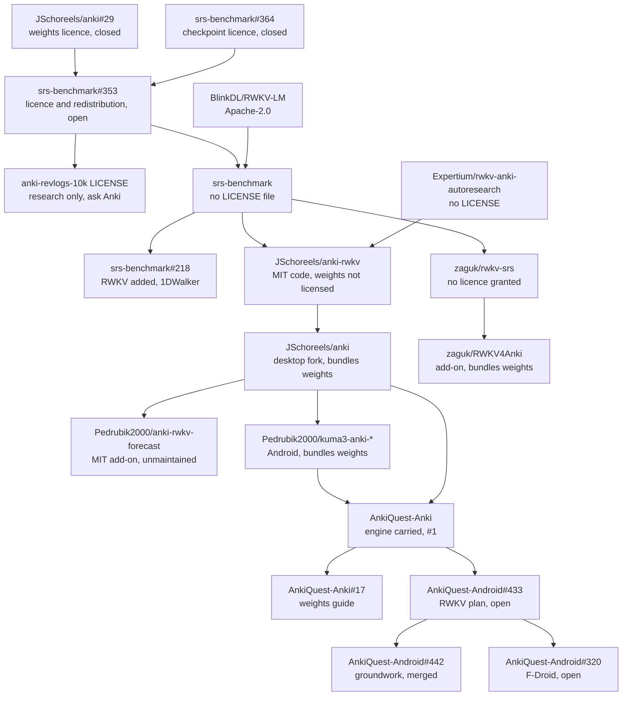

# RWKV scheduling for Anki: who does what

The state of RWKV scheduling for Anki, traced from
[JSchoreels/anki#29](https://github.com/JSchoreels/anki/issues/29) and
[open-spaced-repetition/srs-benchmark#364](https://github.com/open-spaced-repetition/srs-benchmark/issues/364).
Every statement links its source; commits are the default branch heads read
on 2026-11-25. How a player gets the weights, and what AnkiQuest does about
them, is in [rwkv-weights.md](rwkv-weights.md).

## The chain

Both starting issues ask whether AnkiQuest may use the weights. Neither got
an answer from the owners; both are closed with a link to
[srs-benchmark#353](https://github.com/open-spaced-repetition/srs-benchmark/issues/353),
which already asks the same question and is still open.

srs-benchmark#353 (kunehenry, 2026-09-12, open) asks which licences cover the
RWKV code at srs-benchmark commit `b4b02549` and the checkpoint
`pretrain/RWKV_trained_on_5000_10000.pth` (SHA-256 `8fb7fea0…beeeb`), for an
offline web app (ONNX Runtime Web). Replies:

- Expertium: the repository has no licence file; the model was trained on
  `anki-revlogs-10k`, whose licence allows memory research only; ask the Anki
  developers before shipping weights. Asked L-M-Sherlock to add a licence file,
  and abdnh to make the dataset licence explicit for personal use, free forks
  or apps, and paid apps; says Dae wrote the dataset licence.
- L-M-Sherlock: "I thought nobody use them directly."
- wlo2 (2026-10-18): also wants to know, for an open-source SRS app.

No licence file has been added since: srs-benchmark `57c0b07` has none at the
root; `dataset/LICENSE` says "This data is provided for usage in the FSRS
project. Please request permission on https://anki.tenderapp.com before using
it in other contexts."

## Links

Licence questions:

- [JSchoreels/anki#29](https://github.com/JSchoreels/anki/issues/29): AnkiQuest's permission request, closed, links #353.
- [srs-benchmark#364](https://github.com/open-spaced-repetition/srs-benchmark/issues/364): AnkiQuest's permission request, closed, links #353.
- [srs-benchmark#353](https://github.com/open-spaced-repetition/srs-benchmark/issues/353): open, no decision.
- [anki-revlogs-10k LICENSE](https://huggingface.co/datasets/open-spaced-repetition/anki-revlogs-10k/blob/main/LICENSE): not read for this page; quoted as "memory research only" in #353 and as "memory research, and by university students and individuals for their own research; other uses need permission" in anki-rwkv's `WEIGHTS-NOTICE.md`.

Research and training:

- [srs-benchmark#218](https://github.com/open-spaced-repetition/srs-benchmark/pull/218): 1DWalker adds RWKV (merged 2025-05-29); later [#222](https://github.com/open-spaced-repetition/srs-benchmark/pull/222), [#251](https://github.com/open-spaced-repetition/srs-benchmark/pull/251), [#254](https://github.com/open-spaced-repetition/srs-benchmark/pull/254), [#273](https://github.com/open-spaced-repetition/srs-benchmark/pull/273), [#284](https://github.com/open-spaced-repetition/srs-benchmark/pull/284) (description, setup, CPU fallback). The checkpoints `pretrain/RWKV_trained_on_101_4999.pth` and `RWKV_trained_on_5000_10000.pth` are committed there.
- [srs-benchmark#360](https://github.com/open-spaced-repetition/srs-benchmark/pull/360): JSchoreels, FSRS7-Instant, draft.
- [JSchoreels/anki-rwkv](https://github.com/JSchoreels/anki-rwkv) (`3c797f6`): JSchoreels' training "factory" (one RTX 5080, AI agents, owner approves releases). Imports srs-benchmark at `3effecc3` (`upstream.json`) and Expertium's code (`expertium/upstream.json`). Code MIT; weights excluded by `WEIGHTS-NOTICE.md`. Releases: `small-model-sm40-2026-10-19` to `sm72e20-2026-10-29`, then [`rwkv-family-2026-11-13`](https://github.com/JSchoreels/anki-rwkv/releases/tag/rwkv-family-2026-11-13) (Big, Small, Tiny; two-head and Instant-Only). The next family (SM91s2, SM99, SM118, SM113, SM130) is packaged (SM166) but not published; its decision log says release and Hugging Face uploads need the owner's OK.
- [Expertium/rwkv-anki-autoresearch](https://github.com/Expertium/rwkv-anki-autoresearch) (`f256d55`): Expertium's small architectures (iter36, 192,800 parameters); no licence file.

Clients:

- [JSchoreels/anki](https://github.com/JSchoreels/anki) (`eda153d`): desktop fork (FSRS-7, RWKV-Curve, RWKV-Instant), Rust engine in `rslib/src/rwkv/`. Latest release [26.09.4+fsrs7.build.115](https://github.com/JSchoreels/anki/releases/tag/26.09.4%2Bfsrs7.build.115) (2026-11-14). The release candidate (rc-2026-11) is merged into its `main` (anki-rwkv decision log); not yet released. Open RWKV bugs: [#30](https://github.com/JSchoreels/anki/issues/30) (Curve intervals stale after sync), [#31](https://github.com/JSchoreels/anki/issues/31) (slow history-reset lookup), [#32](https://github.com/JSchoreels/anki/issues/32) (panic on negative revlog duration). Proposed fix [#22](https://github.com/JSchoreels/anki/pull/22) is linked from kuma3's `RWKV.md`.
- [Pedrubik2000/kuma3-anki-app](https://github.com/Pedrubik2000/kuma3-anki-app) (branch `rwkv`, `617683a`), with `kuma3-anki-core` and `kuma3-anki-backend`: AnkiDroid fork running the fork's models offline. Latest release v35 (2026-11-24).
- [Pedrubik2000/anki-rwkv-forecast](https://github.com/Pedrubik2000/anki-rwkv-forecast) (`378f802`): add-on showing RWKV-Instant forecasts on the JSchoreels fork; MIT; "No longer maintained (October 2026)".
- [zaguk/rwkv-srs](https://github.com/zaguk/rwkv-srs) (`a0cef76`) and [zaguk/RWKV4Anki](https://github.com/zaguk/RWKV4Anki) (`4149668`): an independent Rust/PyO3 runtime and an add-on for stock Anki Desktop 26.05+, written by Codex under human direction, generated mirrors of a private repository. Models V1 (the srs-benchmark checkpoints converted to safetensors) and V5o-a. Latest add-on release v0.1.2.

AnkiQuest:

- [AnkiQuest-Anki#1](https://github.com/AnkiQuest/AnkiQuest-Anki/pull/1): carries the RWKV engine and kuma3's offline scheduler (merged 2026-11-21).
- [AnkiQuest-Anki#17](https://github.com/AnkiQuest/AnkiQuest-Anki/pull/17): the weights guide, [rwkv-weights.md](rwkv-weights.md).
- [AnkiQuest-Android#433](https://github.com/AnkiQuest/AnkiQuest-Android/issues/433): the plan, open.
- [AnkiQuest-Android#442](https://github.com/AnkiQuest/AnkiQuest-Android/pull/442): settings switch, phone checks and engine seam; no engine and no model source yet (`NoRwkvEngine`, `NoRwkvModel`).
- [AnkiQuest-Android#489](https://github.com/AnkiQuest/AnkiQuest-Android/pull/489): RWKV forecast in the stats, open.
- [AnkiQuest-Android#320](https://github.com/AnkiQuest/AnkiQuest-Android/issues/320): F-Droid, open.

## Who works on what

| Person | Work | Where |
|---|---|---|
| 1DWalker | Original RWKV for SRS, the srs-benchmark checkpoints | srs-benchmark#218 |
| Expertium | Small architectures, benchmark upkeep, the #353 replies | rwkv-anki-autoresearch, srs-benchmark |
| L-M-Sherlock | srs-benchmark maintainer; asked to add a licence | srs-benchmark |
| JSchoreels | Desktop fork, model training and releases, FSRS-7 | JSchoreels/anki, anki-rwkv, fsrs-rs |
| Pedrubik2000 | Android port (kuma3), forecast add-on | kuma3-anki-*, anki-rwkv-forecast |
| zaguk | Independent runtime and stock-Anki add-on | rwkv-srs, RWKV4Anki |
| kunehenry, wlo2 | Third parties waiting on the licence | srs-benchmark#353 |
| AnkiQuest | Carries the engine; Android groundwork | AnkiQuest-Anki, AnkiQuest-Android |

## Licences

| Item | Licence |
|---|---|
| srs-benchmark code and checkpoints | None (no LICENSE file at `57c0b07`); #353 open |
| anki-revlogs-10k (training data of every model below) | Research use; other uses need permission from Anki |
| RWKV-LM (architecture origin) | Apache-2.0 |
| Expertium/rwkv-anki-autoresearch | None |
| JSchoreels/anki-rwkv code | MIT |
| anki-rwkv weights (`weights.*.bin`, `master.pth`) | None; `WEIGHTS-NOTICE.md`: personal and research use until #353 settles, ask the dataset owners before shipping in an application |
| JSchoreels/anki | AGPL-3.0-or-later (Anki); bundled weights under the same notice |
| kuma3-anki-* | GPL-3.0-or-later (AnkiDroid) and AGPL-3.0-or-later; weights "shipped in kuma3 with his permission" (`RWKV.md`) |
| zaguk/rwkv-srs, RWKV4Anki | "No license is granted"; `PROVENANCE.md`: permission to redistribute the V1 checkpoints was obtained (2026-07-17), evidence private, "it does not grant a public license" |
| anki-rwkv-forecast | MIT; contains no weights |
| AnkiQuest-Anki | AGPL-3.0-or-later; contains no weights (`.gitignore`) |

## Open questions

1. Will srs-benchmark add a licence for its code and checkpoints (#353)?
2. Will the dataset's owners (Anki, through anki.tenderapp.com) permit
   redistribution of models trained on `anki-revlogs-10k`, and for free or
   paid apps? Every model listed here was trained on it, directly or through
   the srs-benchmark teacher.
3. Will JSchoreels license the anki-rwkv weights once 1 and 2 are settled?
   His notice says it "will be updated once permission is clarified".
4. Does a client that downloads weights from their author's release count
   as "shipping them in an application"? The notice does not say.
5. When does the next anki-rwkv family (SM118, SM113, SM130) get published,
   and does AnkiQuest-Anki port the matching fork changes? The engine we
   carry reads the build-115 family files.
</content>
</invoke>
